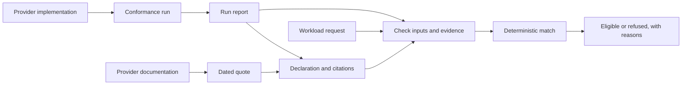

# Sandbox Provider Specification

A common contract for sandbox capabilities across providers: a workload states what it
relies on, a provider declaration states what a sandbox offers, with evidence for each
value, and a shared matcher decides whether the two fit.

**Status: Format 0.1 working draft.** [Read the specification](spec/README.md) · [Changelog](CHANGELOG.md) · [Contribute](CONTRIBUTING.md)

> [!IMPORTANT]
> **Experimental and under active development.** The 0.x format may still change in
> incompatible ways between versions, including what an existing file means. Contributions
> and feedback are welcome: if a workload you care about cannot be expressed, or a rule
> cannot be implemented or tested, please [open an issue or propose a change](CONTRIBUTING.md#changing-the-specification).

## Why this exists

Sandbox providers offer similar primitives behind different APIs and with different
guarantees. "Snapshots" may save memory or only files. A "private" preview may be a signed
link or a header. An egress allowlist may take host names or only IP addresses, with or
without wildcards. Pausing may keep processes alive or only files. Isolation may be a
dedicated kernel or the host's. Lifetimes, regions, sizes, root access and image support
all differ, and a feature page rarely shows how.

Code that runs in a sandbox relies on those details. An agent that pauses overnight expects
its running processes back in the morning. A pipeline that handles customer data expects
outbound traffic limited to two hosts, enforced outside the sandbox where the code cannot
lift it. Every tool that supports more than one provider (agent frameworks, SDKs, routers,
evaluation harnesses) ends up keeping its own private matrix of these differences, written
by hand from documentation and rarely rechecked. When the matrix is wrong, a program written
for one provider breaks on another, at run time.

This specification standardizes the portable behaviour, not the provider APIs. It names what
a program can rely on, defines how to test it, and lets every tool reach the same answer
from the same evidence.

## The model

- A **request** states what a workload relies on.
- A **declaration** states what a provider (or one class of sandbox it offers, such as
  containers or VMs) offers, with evidence for every value.
- **Matching** decides, deterministically and with reasons, whether a declaration satisfies
  a request.
- **Conformance tests**, written once for every provider, produce the evidence.

Each party has one job. A provider (or anyone, with evidence) writes and maintains a
declaration. A developer writes a request for a workload. A tool, such as an SDK, an agent
framework or a router, matches requests against declarations before it creates a sandbox.

The contract describes behaviour, not a programming interface. An implementation can call a
provider's own API or SDK, or speak an optional transport binding. The
[HTTP binding](spec/binding-http.md) is a draft of one such wire protocol; it is unreleased,
and existing conformance reports do not prove it. Whichever path an implementation takes,
requests, declarations and matching stay the same.



## A workload request

A request names only what the program relies on. This one is for a coding agent that keeps
its sandbox for a day, pauses between sessions with its processes intact, shows its user a
dev server on port 3000, and may reach only `api.github.com`:

<!-- sps:example file=coding-agent.yaml -->

```yaml
lifetime_seconds: 86400
at_end: paused
requirements:
  pause_resume: {keeps: files_and_memory}
  previews: {access: public, ports: [3000]}
  network_lockdown: {policy: allowlist, allow: [api.github.com]}
resources:
  memory_min_mib: 4096
```

`check` validates a file against the format, offline, with no provider SDK, account or
Docker daemon. `ok` means the file is well formed; it does not prove that any provider
satisfies it:

<!-- sps:example exit=0 stream=stdout -->

```console
$ sandbox-provider-spec check coding-agent.yaml
coding-agent.yaml: ok
```

[Example requests](examples/requests/) cover other common workloads, such as a code
interpreter, a Docker build, GPU inference and a computer-use agent.

## A provider declaration

A declaration answers in the same words as a request. Every value cites a conformance test
in a committed run report or, for facts no test can reach, a dated quote of the provider's
documentation. A short illustrative one looks like this:

```yaml
spec: sandbox-provider-spec/0.1
provider: example
verified: {date: 2026-10-01, sdks: {example-sdk: "1.4.2"}}
resources: {kernel: dedicated}
gates:
  pause_resume: [{keeps: files_only}]
evidence:
  resources.kernel:
    source: https://docs.example.com/security
    read: 2026-10-01
    quote: Every sandbox is a microVM with its own kernel.
  gates.pause_resume.0.keeps:
    tests: [pause_resume.files_only]
    report: reports/2026-10-01-core.json
```

A gate a declaration leaves out, or a value it marks `unknown`, never counts as support.

## The matching result

Matching the request above against the bundled declarations of five providers
([E2B][e2b], [Modal][modal], [Daytona][daytona], [Blaxel][blaxel] and [Vercel][vercel])
gives a reason for every refusal. `installed-declaration` prints the path of a declaration
the installed package bundles. E2B requires `pro_plan` for a 24-hour lifetime;
`--met-need pro_plan` says the account meets that need:

<!-- sps:example exit=1 stream=stdout -->

```console
$ sandbox-provider-spec match coding-agent.yaml --met-need pro_plan \
    "$(sandbox-provider-spec installed-declaration e2b)" \
    "$(sandbox-provider-spec installed-declaration modal)" \
    "$(sandbox-provider-spec installed-declaration daytona --class container)" \
    "$(sandbox-provider-spec installed-declaration blaxel)" \
    "$(sandbox-provider-spec installed-declaration vercel)"
e2b: not eligible
  - baseline_failed: no newest clean baseline-passing report for this provider, class and SDK set
  - limit_exceeded: variant 1: entry_kinds ['addresses'] does not cover ['names']; variant 2: policy: asked ['allowlist'], offers ['deny_all']
modal/default: not eligible
  - baseline_failed: no newest clean baseline-passing report for this provider, class and SDK set
  - gate_not_listed: pause_resume: not declared; nobody has looked
  - resource_mismatch: at_end: asked paused, declared ['destroyed']
daytona/container: not eligible
  - baseline_failed: no newest clean baseline-passing report for this provider, class and SDK set
  - knob_mismatch: variant 1: keeps: asked ['files_and_memory'], offers ['files_only']
  - gate_not_listed: network_lockdown: not declared; nobody has looked
  - resource_mismatch: at_end: asked paused, declared ['destroyed']
blaxel: not eligible
  - baseline_failed: no newest clean baseline-passing report for this provider, class and SDK set
  - gate_not_listed: pause_resume: not declared; nobody has looked
  - gate_not_listed: network_lockdown: not declared; nobody has looked
  - resource_mismatch: at_end: asked paused, declared ['destroyed']
vercel: not eligible
  - baseline_failed: no newest clean baseline-passing report for this provider, class and SDK set
  - knob_mismatch: variant 1: keeps: asked ['files_and_memory'], offers ['files_only']
  - knob_mismatch: variant 1: policy: asked ['allowlist'], offers ['deny_all']
  - resource_mismatch: at_end: asked paused, declared ['destroyed', 'stopped']
```

Each reason points at one line of the request. E2B declares address allowlists only, so it
cannot allow the host name `api.github.com`. Daytona and Vercel declare a pause that keeps
files but not running processes. Several of these providers "support pause"; they do not all
support the same pause.

Matching is offline: exit 0 means at least one supplied declaration qualifies; exit 1 means
none qualifies or an input is invalid. `baseline_failed` means the cited reports do not
establish the [baseline](#covered-capabilities) every provider must pass. A clean report
confirms cleanup; it does not mean tests passed. Which of several eligible providers to use
(price, speed, reliability) is left to whoever chooses; the specification only says which
ones qualify.

[e2b]: providers/e2b/declaration.yaml
[modal]: providers/modal/declaration.yaml
[daytona]: providers/daytona/declaration-container.yaml
[blaxel]: providers/blaxel/declaration.yaml
[vercel]: providers/vercel/declaration.yaml

## Covered capabilities

Optional features are **gates**; their differing details are **knobs**; provider-wide properties
such as sizes and regions are **facts**. Each row explains why a provider can serve a workload.

| If your code relies on | The specification's terms |
| --- | --- |
| Pausing and resuming, with or without running processes | `pause_resume` (`keeps`) |
| Saving a sandbox and starting new ones from the save | `snapshots` (`keeps`, `original_after`, `retention_seconds`) |
| Stopping when idle, and waking on demand | `idle_shutdown` (`on_idle`, `custom_idle_time`, `auto_wake`) |
| A URL to a port: public or private, revocable, WebSocket-capable, surviving a pause | `previews` |
| A raw TCP port reachable from the internet | `tcp_ports` |
| Outbound traffic limited to an allowlist or denylist, enforced outside the sandbox | `network_lockdown` (`policy`, `changeable`, `switchable`, wildcards, entry kinds) |
| Credentials added to outgoing requests that code in the sandbox cannot read | `hidden_secrets` |
| Storage that outlives the sandboxes that mount it | `volumes` (`kind`, `sharing`, `read_only_mounts`) |
| Starting from your own OCI image or Dockerfile, prepared ahead of time | `custom_images` (`source`, `prepared`, `image_config`, `runs_entrypoint`) |
| Sending input to, cancelling, or reattaching to a background process | `processes` |
| An interactive terminal, and reattaching to it | `terminal` |
| Running commands, writing files and starting processes as a named user | `user_selection` |
| A Docker Engine inside the sandbox | `docker` |
| A graphical desktop a program drives | `desktop` |
| A link that reads or writes one file, to hand to another client | `file_links` (`operations`, `user_selection`, `link_lifetime_seconds`, `revocable`) |
| CPU, memory, disk and GPUs, and whether the size is a hard ceiling | `cpu_min`, `memory_min_mib`, `disk_min_mib`, `gpu_model`, `gpu_count`, `size_is_ceiling` |
| Where it runs: a region, an area or a country | `region` (with `regions` and `located_in`) |
| A dedicated kernel, or kernel features such as FUSE or eBPF | `kernel`, `kernel_features` |
| How long it may live, what happens at the end, how long a paused one is kept | `lifetime_seconds`, `at_end`, `extendable_lifetime`, `paused_retention_seconds` |
| How long a command or background process may run | `run_seconds`, `process_seconds` |
| Root access, CPU architecture, package manager and C library | `root`, `arch`, `package_manager`, `libc` |
| Outbound traffic beyond HTTPS, and stable egress addresses | `outbound_traffic`, `egress_ips` |
| Moving a large file in or out in one streamed transfer | `file_stream_bytes` (with `file_stream_max_bytes`) |

Beneath all of this sits a **baseline** every provider must pass and no request asks for:
create a sandbox with environment variables, find and destroy it, run commands with separate
output streams, read and write files, stream a background process's output, open outbound
HTTPS, and keep the host's cloud credentials out of reach.

<!-- sps:counts -->
The vocabulary has 16 gates and 47 knobs; the conformance suite has 240 tests.

## Principles

**Only what code relies on.** A word enters the vocabulary only when leaving it out would
let a program be matched to a provider that breaks it. Everything else is a test or a
sentence of documentation.

**When in doubt, no.** `unknown` is a value in its own right, distinct from `unsupported`,
and it never satisfies a request. A word a reader does not know is refused, never guessed.

**Every value rests on evidence.** A test anyone can rerun, or a dated quote of the
provider's own documentation where no test can reach. Run reports record the SDK versions,
test outcomes, and every resource the run created and cleaned up.

**Standardize behaviour, not APIs.** The specification says what a sandbox does, not how
to call it. Providers keep their own APIs; an implementation may use them directly or
through an optional transport binding.

**Matching is shared; choosing is not.** Given the same request and declaration, every
implementation reaches the same answer with the same reasons. Price, speed and reliability
change daily and are measured by whoever chooses; they are never declared.

**No assumption that sandboxes are short-lived.** Lifetime, pausing and persistence are
declared properties, so the same words describe a sandbox that runs one command and one an
agent keeps for weeks.

## Evidence, conformance and tooling

Conformance suites are written once and run against each provider through a thin driver;
the bundled drivers call each provider's own SDK. A run writes a report with every test's
outcome, the SDK versions and the cleanup of every resource it created. Declarations cite
those reports, and `check` verifies the citations.

The Python package provides:

- the `sandbox-provider-spec` command: `check` for requests, declarations and reports;
  `match`; `installed-declaration`; and `run` for conformance;
- the [reference matcher](tests/matcher/README.md#using-the-python-reference-matcher), with
  test vectors for other implementations;
- a [provider onboarding kit](docs/how-to/provider-kit.md) that generates a starter
  declaration, and an [installed HTTP reference](docs/http-binding-reference.md) for the
  draft binding.

Installed wheels include the versioned authoring guides. Outside a source checkout,
read them through the existing public data-directory API:

```python
from sandbox_provider_spec import spec_dir

guides = spec_dir() / "docs"
print((guides / "how-to" / "provider-kit.md").read_text(encoding="utf-8"))
```

The HTTP backend interface reference is `guides / "http-binding-reference.md"`.
The guides' relative hyperlinks describe the repository layout; installed schemas
and normative specification documents live directly under `spec_dir()`.

### Run Docker conformance

Follow the [Docker conformance guide](docs/how-to/run-conformance.md) with a running engine,
[uv](https://docs.astral.sh/uv/) and network access; no provider account is needed. Other providers
need SDKs and credentials. Runs may be billed and attempt to clean up every resource they create.

`https://example.com/` is a fixture placeholder. Before each run, verify direct HTTPS
reachability from both the runner and guest; replace the URL if either check fails. An
unreachable fixture can produce `baseline.outbound_network: probe_connection_failed`.

Cold runs pull public images from Docker Hub. Anonymous pull limits can produce HTTP 429,
an `APIError` and image-dependent tests marked `not_run`. Authenticate with `docker login`
or configure a [cached registry mirror](https://docs.docker.com/docker-hub/image-library/mirror/)
for the daemon the SDK uses. Cleanup alone does not make the run pass.

### Documentation

| Read | To |
| --- | --- |
| [Tutorial](docs/getting-started.md) | Check a request and interpret a match without an account |
| [Compare providers](docs/how-to/compare-providers.md) | Compare bundled or external declarations |
| [Read evidence](docs/how-to/read-evidence.md) | Understand reports, refusals and conformance claims |
| [Add a provider](docs/how-to/add-provider.md), [run conformance](docs/how-to/run-conformance.md) | Write a declaration and driver; produce reports |
| [Evidence and unknown values](docs/explanation/evidence-and-unknown.md) | Understand why unknown or missing evidence cannot establish support |
| [Specification index](spec/README.md), [spec.md](spec/spec.md) | Understand baseline, gates, knobs, facts, requests and matching |
| [vocabulary.md](spec/vocabulary.md) | Look up every gate, knob and fact |
| [declarations.md](spec/declarations.md), [conformance.md](spec/conformance.md) | Look up declaration, report and driver rules |
| [matching.md](spec/matching.md) | Implement a matcher using the [test vectors](tests/matcher/README.md) |
| [binding-http.md](spec/binding-http.md) | Read the draft HTTP transport binding |

## Providers

Declarations can live wherever their owners keep them; the tools read any path.
An installed adapter's documentation names its provider ID and execution classes;
`sandbox-provider-spec installed-declaration <provider-id> --class <class>` resolves its
packaged declaration. The [Docker Engine reference](providers/docker-engine/README.md)
is also available as `sandbox-provider-spec installed-declaration docker-engine` without
an account. Its SDK lacks the required command deadline, so it does not pass the baseline.
Declarations describe evidence, not a ranking or a promise that every workload qualifies.

[Governance](GOVERNANCE.md#provider-declarations) defines provider ownership; evidence decides disputes.

## Versions

`main` is the changing working draft; published tags are fixed snapshots. Declarations,
suites and reports carry `spec: sandbox-provider-spec/0.1`, separate from the Python package
version. Requests have no embedded version and are interpreted by the matcher reading them;
unknown file-format versions are refused. See [versioning](GOVERNANCE.md#versioning) and
[conformance claims](GOVERNANCE.md#conformance-claims).

## Contributing

Start with a [good first issue](https://github.com/boxrouter/sandbox-provider-spec/issues?q=is%3Aissue%20is%3Aopen%20label%3A%22good%20first%20issue%22)
or [help wanted](https://github.com/boxrouter/sandbox-provider-spec/issues?q=is%3Aissue%20is%3Aopen%20label%3A%22help%20wanted%22).
Corrections, new providers and vocabulary proposals are welcome. [CONTRIBUTING.md](CONTRIBUTING.md)
explains setup, DCO and proposals; [GOVERNANCE.md](GOVERNANCE.md) explains decisions. Report
vulnerabilities through [SECURITY.md](SECURITY.md). Follow the [Code of Conduct](CODE_OF_CONDUCT.md).

## Development

Python 3.11 or newer with `venv` and `pip` is required. To install the command from source,
start in a [checkout](docs/getting-started.md#install):

<!-- At launch, change only the install argument below from . to sandbox-provider-spec.
     The tutorial links here so there is one installation entry point. -->
<!-- sps:install -->

```sh
python3 -m venv .venv
. .venv/bin/activate
python -m pip install .
```

To work on the specification or the package, use [uv](https://docs.astral.sh/uv/) and run
`make check` as [CONTRIBUTING.md](CONTRIBUTING.md#setting-up) describes.

```text
spec/            The specification, catalog, JSON Schemas, region and GPU registries
conformance/     The shared test suites and the fixtures they run in a sandbox
providers/       Provider declarations and cited reports, including the Docker reference
docs/            Tutorial, task guides and explanations
examples/        Example workload requests
src/             The Python checker, reference matcher, conformance runner and SDK drivers
tests/           Package tests and the reference matcher's test vectors
tools/           Documentation, transcript and boundary checks
```

See [NOTICE](NOTICE) for ownership and copyright. Licensed under [Apache-2.0](LICENSE).
